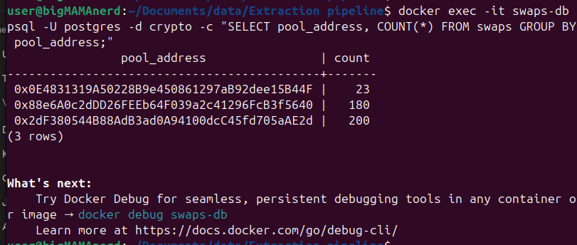

# Swap Extraction Pipeline

Pulls Uniswap V3 Swap events for three pools over a block range and loads them into Postgres.

## Run

```bash
export RPC_URL=<Alchemy URL for the chain>
uv run swap_pipeline.py --from <start> --to <end>
```

## How it works

1. **Extract**: `eth_getLogs` per pool, 10 blocks per request, filtered on the Swap topic. Retries with backoff on RPC errors.
2. **Transform**: each log decoded with the pool ABI via `process_log`. Block timestamps fetched once per block and cached.
3. **Load**: rows go into `swaps`. Primary key `(tx_hash, log_index)` plus `ON CONFLICT DO NOTHING`, so rerunning a range adds zero rows.

Big integers (`amount0`, `amount1`, `sqrtPriceX96`, `liquidity`) are stored as `NUMERIC(78,0)` since they overflow `BIGINT`.

## Results

| Pool | Address | Chain | Block range | Swaps |
|---|---|---|---|---|
| ETH/USDC | 0x88e6A0c2dDD26FEEb64F039a2c41296FcB3f5640 | Ethereum | 20000000 to 20000199 | 180 |
| XDP/USDC | 0x2dF380544B88AdB3ad0A94100dcC45fd705aAE2d | Base | 53361000 to 53361199 | 200 |
| WBTC/USDC | 0x0E4831319A50228B9e450861297aB92dee15B44F | Arbitrum | 520199100 to 520203199 | 23 |

## Finding the right chain

The brief listed all three pools as Ethereum mainnet. On mainnet, XDP/USDC and WBTC/USDC returned 0 swaps. `eth_getCode` showed 0 bytes at both addresses, so no contract exists there.

Checking other chains:
- XDP/USDC has code on **Base**, deployed at block 51905289
- WBTC/USDC has code on **Arbitrum**, deployed at block 105768681

`token0()` and `token1()` confirmed the token pairs on each. WBTC/USDC on Arbitrum is quiet, so it needed a wider range.

## Idempotency

Rerunning the ETH/USDC range:

```
ETH/USDC: 180 swaps found, 0 new rows, 180 already in DB
```
## Proof


